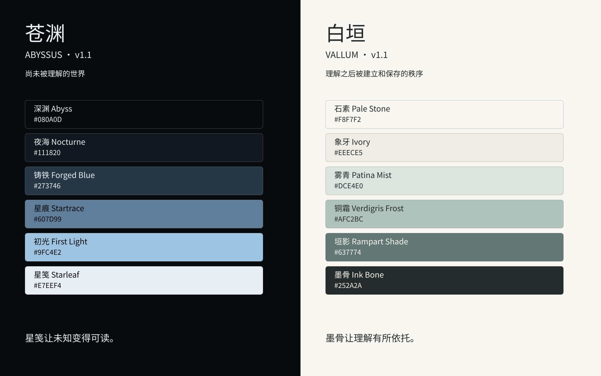

# 苍渊·白垣 · ABYSSUS · VALLUM

**探于苍渊，筑于白垣。**

用于规范配色与设计风格的 AI 技能，包含锁定的双主题颜色、语义 Token、布局与组件规则、文化叙事和参考素材。

苍渊代表探索尚未被理解的世界；白垣代表将理解变成工具、结构与传承。

> 不要添加颜色。给灰色一点色相。

## 使用

让支持本地 Skills 的 AI 工具读取根目录的 [SKILL.md](SKILL.md)，并保留本仓库完整目录，以便按需读取引用文件。

调用示例：

- 使用 `$abyssus-vallum` 设计这个页面。
- 按白垣规范调整现有项目列表，保留原有信息架构。
- 检查这个苍渊仪表盘的配色、对比度和组件风格。

技能负责视觉规范；制作网页、Figma、PPT 等交付物时，可与对应制作工具配合使用。

## 资源

| 路径 | 内容 |
|---|---|
| [SKILL.md](SKILL.md) | 触发范围、执行流程与验收规则 |
| [assets/tokens](assets/tokens) | CSS、JSON、TypeScript 与 DTCG 色值 |
| [references/brand](references/brand) | 文化叙事、命名、颜色和版本规范 |
| [references/ui](references/ui) | 布局、组件、可访问性和迁移规则 |
| [assets/palette-cards](assets/palette-cards) | 精确色卡 |
| [assets/reference-images](assets/reference-images) | 苍渊、白垣配对的界面氛围图与色彩海报 |
| [assets/examples](assets/examples) | 苍渊与白垣 HTML 示例 |



## 前端接入

引入 `assets/tokens/tokens.css`，在根元素设置 `data-theme="vallum"` 或 `data-theme="abyssus"`，组件使用语义 CSS 变量。

```html
<!doctype html>
<html lang="zh-CN" data-theme="vallum">
  <head>
    <meta charset="utf-8">
    <link rel="stylesheet" href="./assets/tokens/tokens.css">
  </head>
  <body>苍渊·白垣</body>
</html>
```

以上路径以项目根目录为例；复制资源后按实际位置调整。主题属性放在 `html` 上，让根元素与页面内容使用同一主题。

接入现有工程时先检查全局样式作用域。白垣主按钮用墨骨背景与石素文字；苍渊主按钮用初光背景与深渊文字。白垣小号强调文字使用 `accentStrong`，仍需检查实际背景上的对比度。主按钮别名和白垣缺省的 `surfaceRaised` 适配见 [前端落地说明](references/ui/FIGMA_AND_FRONTEND.md)。

## 示例与验证

直接用浏览器打开 [白垣项目列表示例](assets/examples/vallum_training_platform_demo.html)或[苍渊监控示例](assets/examples/abyss_dashboard_demo.html)，无需安装依赖。两者是静态视觉参考：业务按钮禁用，搜索只演示输入样式，导航和监控数据没有接入业务。

维护时检查：

- 技能入口和 Markdown 链接能在本仓库内解析；图片索引中的素材实际存在。
- 四种 Token 导出的同名颜色和主题映射一致；保留既有语义色值，不通过示例修正 Token。
- 两个示例在 1440、1920 和 390px 宽度下无横向溢出，长文本可换行，搜索框标签和键盘焦点可用。
- 依据 [可访问性说明](references/ui/ACCESSIBILITY.md)核对实际文字与背景组合。

安装了 `skill-creator` 技能时，可用其 `scripts/quick_validate.py` 校验本技能目录；格式校验不能替代资源、对比度和浏览器检查。

## 版本与素材

视觉规范基于用户提供的 `abyssus-vallum-design-system-v1.0` 源包（2026-09-29）。当前规范为 v1.1：将已有苍渊主文字色 `#E7EEF4` 命名为“星笺 / Starleaf”，双主题均具备六个核心色；既有语义色值不变。四份 Token 已同步，v1.0 快照保留在 Git 历史中，迁移说明见 [版本锁](references/brand/VERSION_LOCK.md)。使用技能不依赖临时源包目录。

精确色值以 Token 文件为准，不从 AI 生成图重新吸色覆盖。DTCG 文件保留源包的 HEX 字符串表示；若目标导入器要求其他颜色结构，在目标项目中转换，勿覆盖仓库锁定值。

参考图仅保留苍渊与白垣各两张生成图，编号为 01–04；用途与生成提示词见 [REFERENCE_INDEX.md](assets/reference-images/REFERENCE_INDEX.md)。商品截图、原始照片、平台截图及临时原始目录和 ZIP 已从当前工作目录移除；精确色卡和技能图标保留。此清理不重写 Git 历史，旧提交仍可能包含已删除素材。本仓库尚未声明统一的开源许可证。
