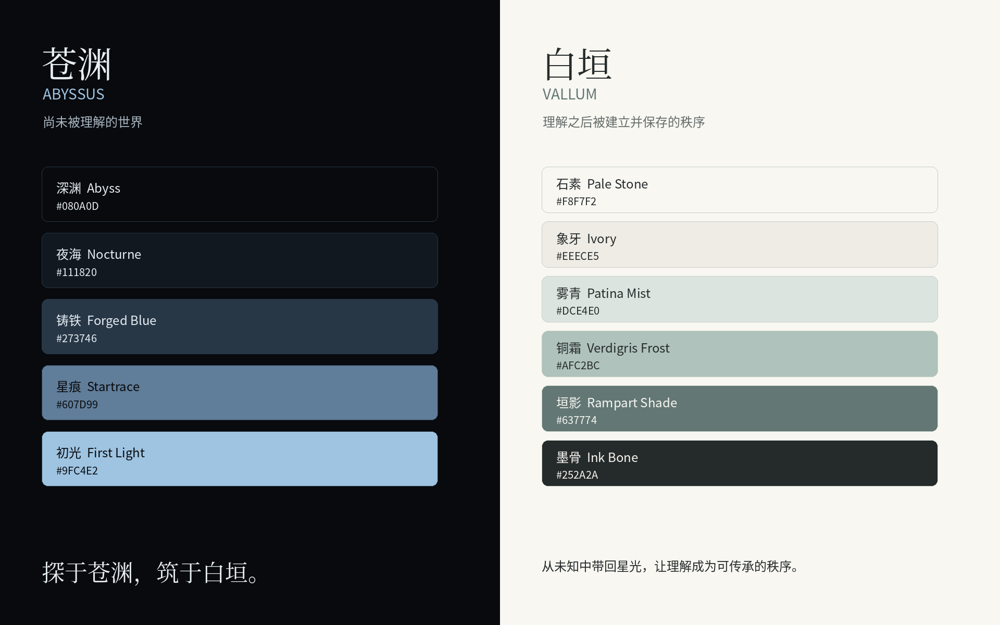

# 苍渊·白垣 · ABYSSUS · VALLUM

**探于苍渊，筑于白垣。**

用于规范配色与设计风格的 AI 技能，包含锁定的双主题颜色、语义 Token、布局与组件规则、文化叙事和参考素材。

苍渊代表探索尚未被理解的世界；白垣代表将理解变成工具、结构与传承。

> 不要添加颜色。给灰色一点色相。

## 使用

让支持本地 Skills 的 AI 工具读取根目录的 [SKILL.md](SKILL.md)，并保留本仓库完整目录，以便按需读取引用文件。

调用示例：

- 使用 `$abyssus-vallum` 设计这个页面。
- 按白垣规范调整现有项目列表，保留原有信息架构。
- 检查这个苍渊仪表盘的配色、对比度和组件风格。

技能负责视觉规范；制作网页、Figma、PPT 等交付物时，可与对应制作工具配合使用。

## 资源

| 路径 | 内容 |
|---|---|
| [SKILL.md](SKILL.md) | 触发范围、执行流程与验收规则 |
| [assets/tokens](assets/tokens) | CSS、JSON、TypeScript 与 DTCG 色值 |
| [references/brand](references/brand) | 文化叙事、命名、颜色和版本规范 |
| [references/ui](references/ui) | 布局、组件、可访问性和迁移规则 |
| [assets/palette-cards](assets/palette-cards) | 精确色卡 |
| [assets/reference-images](assets/reference-images) | 材料、光感及界面参考 |
| [assets/examples](assets/examples) | 苍渊与白垣 HTML 示例 |



## 前端接入

引入 `assets/tokens/tokens.css`，在根元素设置 `data-theme="vallum"` 或 `data-theme="abyssus"`，组件使用语义 CSS 变量。

```html
<link rel="stylesheet" href="./assets/tokens/tokens.css">
<html data-theme="vallum">
```

接入现有工程时先检查全局样式作用域。白垣主按钮用墨骨色；小号强调文字用 accentStrong。实际前景与背景组合仍需检查对比度。

## 版本与素材

视觉规范基于 v1.0。精确色值以 Token 文件为准，不从摄影或 AI moodboard 重新吸色覆盖。

参考图片的用途见 [REFERENCE_INDEX.md](assets/reference-images/REFERENCE_INDEX.md)。公开存放参考素材不等于授予第三方图片的再使用许可。本仓库尚未声明统一的开源许可证。
